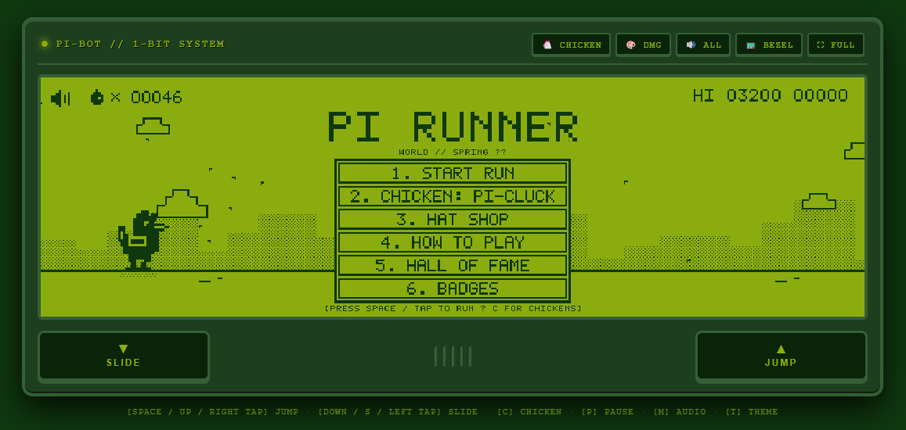
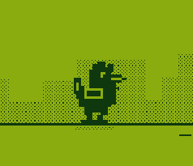
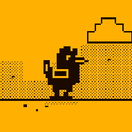
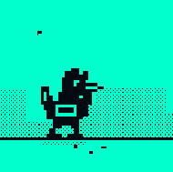
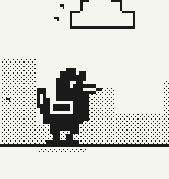

# Chicken Runner
 
`Jogo de navegador` · `Endless runner` · `JavaScript` · `HTML5 Canvas` · `Pixel art` · `Retro` · `WebAudio`

Chicken Runner é um jogo de corrida infinita em estilo retrô, desenvolvido em JavaScript puro com HTML5 Canvas. O jogador controla uma galinha que corre por um cenário arcade 1-bit, desviando de obstáculos e coletando ovos.

## Como executar

Abra `index.html` em um navegador moderno. Não é necessário instalar dependências.

## Recursos

- Cinco personagens jogáveis
- Pulos, deslizes e obstáculos
- Pontuação, recordes locais e ranking
- Ovos coletáveis e chapéus cosméticos desbloqueáveis
- Conquistas e múltiplos temas visuais retrô
- Efeitos sonoros e música sintetizados com WebAudio
- Controles de teclado e controles virtuais para telas sensíveis ao toque
- Preferências e progresso salvos no navegador com LocalStorage

## Visuais

|DMG|AMBER|CYBER|MAC|
|--|--|--|--|
|||||
|Paleta verde clássica do Game Boy, com fundo verde-limão e elementos verde-escuros.|Tons âmbar de arcade, com fundo dourado e elementos quase pretos.|Visual cyberpunk em ciano vibrante e azul-marinho quase preto.|Estilo clássico de Macintosh, em branco quente e preto.|

## Tecnologias

- HTML5, CSS3 e JavaScript
- Canvas API para renderização do jogo
- WebAudio API para áudio
- LocalStorage para salvar dados localmente

### Controles

- **Pular:** Espaço, seta para cima ou botão de toque
- **Deslizar:** seta para baixo ou botão de toque
- **Pausar:** P
- **Trocar personagem:** C
- **Alternar áudio:** M
- **Trocar tema:** T

## Estrutura

- `index.html` — estrutura da página e interface do jogo
- `css/style.css` — estilos e apresentação responsiva
- `js/game.js` — lógica do jogo, renderização, áudio e progressão
- `assets/` — arquivos auxiliares

## Desenvolvimento

O projeto está sendo desenvolvido com o Opencode e o modelo MIMO flash.
