# Chicken Runner
 
`Jogo de navegador` · `Endless runner` · `JavaScript` · `HTML5 Canvas` · `Pixel art` · `Retro` · `WebAudio`

Chicken Runner é um jogo de corrida infinita em estilo retrô, desenvolvido em JavaScript puro com HTML5 Canvas. O jogador controla uma galinha que corre por um cenário arcade 1-bit, desviando de obstáculos e coletando estrelas.

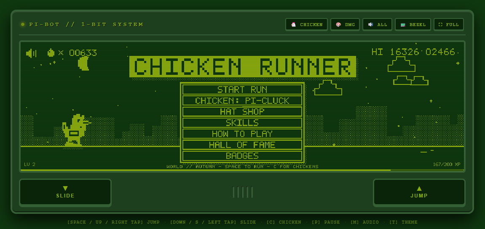

## Como executar

Abra `index.html` em um navegador moderno. Não é necessário instalar dependências.

## Recursos

- Cinco personagens jogáveis (cosméticos, sem vantagem de gameplay)
- Pulos, deslizes e obstáculos
- Pontuação, Hall of Fame (top 5 local com distância, estrelas e data)
- Estrelas coletáveis que viram moeda no banco, para comprar chapéus na loja
- Sistema de XP com níveis e árvore de skills de evolução (3 ramos)
- Seis conquistas (badges) desbloqueáveis durante as corridas
- Tutorial interativo de treino com recompensa única (+50 estrelas e +50 XP)
- Quatro estações e ciclo dia/noite que mudam ao longo da corrida
- Cinco temas visuais 1-bit (B&W, DMG, AMBER, MAC, CYBER)
- Efeitos sonoros e música sintetizados com WebAudio (modos ALL, SFX e OFF)
- Controles de teclado e controles virtuais para telas sensíveis ao toque
- Preferências e progresso salvos no navegador com LocalStorage

## Visuais

|DMG|AMBER|CYBER|MAC|
|--|--|--|--|
|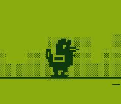|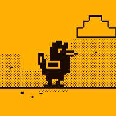|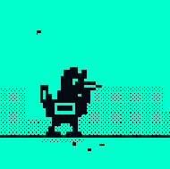|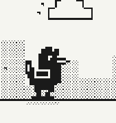|
|Paleta verde clássica do Game Boy, com fundo verde-limão e elementos verde-escuros.|Tons âmbar de arcade, com fundo dourado e elementos quase pretos.|Visual cyberpunk em ciano vibrante e azul-marinho quase preto.|Estilo clássico de Macintosh, em branco quente e preto.|

Além dos quatro temas acima, existe a paleta **B&W** (preto e branco puro), que é o tema padrão do jogo e não tem imagem de referência aqui. Use `T` para alternar entre os cinco.

## Chars

Cinco galinhas jogáveis, escolhidas no menu **CHICKEN** do menu principal ou pela tecla `C`. Todas são **puramente cosméticas**: nenhuma altera velocidade, pulo ou hitbox; a escolha fica salva no navegador.

|Pi-Cluck|Rex|Chubby|Mecha|Shinobi|
|--|--|--|--|--|
|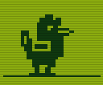|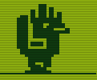|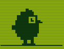|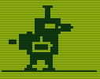|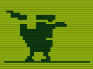|
|**A galinha original**: equilibrada, destemida e pronta para a maratona.|**O rei majestoso**: anda com estilo, crista gigante e cauda esvoaçante.|**A bolinha fofa**: 90% pena, 10% galinha, esfera de determinação.|**Unidade cibernética 3.14**: bico de titânio e visor, zero lag orgânico.|**A sombra silenciosa**: silenciosa como uma pena, corre pelas sombras.|

## Hats

Os chapéus são **cosméticos** e não afetam o gameplay. Eles são comprados com as **estrelas do banco** (coletadas nas corridas e depositadas ao fim de cada run) na **HAT SHOP** do menu principal, e podem ser trocados quando quiser.

|Grad Cap|Top Hat|Viking Helm|
|--|--|--|
|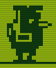|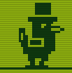|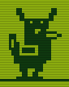|
|**GRAD CAP**: 20 estrelas: excelência acadêmica.|**TOP HAT**: 35 estrelas: galinha elegante e bem-vestida.|**VIKING HELM**: 60 estrelas: conquistador emplumado.|

Os demais chapéus do jogo (sem imagem de referência no repositório):

|Chapéu|Custo|Descrição|
|--|--|--|
|NONE|Grátis|Cabeça nua clássica: o padrão, já vem liberado.|
|RIBBON COMB|15 estrelas|Laço xadrez: um toque fofo e colorido.|
|CHEF TOQUE|50 estrelas|Touca de chef: alta culinária ensolarada.|
|EGG CROWN|80 estrelas|Coroa de ovos: herdeiro real do ninho.|

## Skill Tree

A árvore de evolução é aberta pelo menu **SKILLS** e usa **XP como moeda**: o mesmo XP dos níveis (desbloquear um nó consome XP e pode até fazer o nível cair). O nó de entrada libera **três ramos**; cada habilidade exige a anterior na sua coluna e fica salva permanentemente. Navegue com as setas e pressione `Enter` para desbloquear.

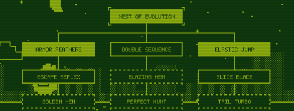

|Skill|Custo (XP)|Pré-requisito|Efeito|
|--|--|--|--|
|NEST OF EVOLUTION|50|:|Ponto de entrada: abre os três ramos da árvore.|
|ARMOR FEATHERS|120|Nest of Evolution|Um escudo por corrida absorve uma colisão.|
|DOUBLE SEQUENCE|100|Nest of Evolution|Estrelas valem 30 de pontuação e o combo dura 2,4 s.|
|ELASTIC JUMP|100|Nest of Evolution|Pulo 6% mais alto e janela de pulo (buffer) mais longa.|
|ESCAPE REFLEX|200|Armor Feathers|Após o escudo bloquear um golpe: 2 s de invencibilidade e velocidade −10% por 3 s.|
|BLAZING HEN|180|Double Sequence|Com combo x8 ou maior, as estrelas valem o dobro.|
|SLIDE BLADE|180|Elastic Jump|Hitbox do deslize 20% menor.|
|GOLDEN HEN|320|Escape Reflex|O escudo se renova a cada 500 m percorridos.|
|PERFECT HUNT|300|Blazing Hen|Desvio quase-acerto (near-miss) vale 25 pontos em vez de 10.|
|TAIL TURBO|300|Slide Blade|Começa a 440 de velocidade e acelera 15% mais rápido.|

## Progressão (XP e níveis)

O XP alimenta os níveis e é a moeda da árvore de skills. Como obtê-lo:

- **Distância:** 1 XP a cada 10 m percorridos.
- **Estrelas:** +2 XP por estrela coletada (elas também entram no banco ao fim da corrida).
- **Conquistas:** +25 XP por badge desbloqueado.
- **Treino:** +50 XP (e +50 estrelas) na conclusão do tutorial.

O nível sobe automaticamente conforme o XP acumulado (o custo por nível aumenta a cada avanço). Tudo fica salvo no LocalStorage.

## Conquistas

Seis badges desbloqueados durante as corridas (cada um concede +25 XP):

|Badge|Condição|
|--|--|
|FIRST FLIGHT|Completar a primeira corrida.|
|NIGHT OWL|Sobreviver ao período noturno.|
|FOUR SEASONS|Alcançar a neve do inverno.|
|STAR MAGNATE|Ter 50 estrelas (na corrida ou no banco).|
|SPEED DEMON|Ultrapassar 750 px/s de velocidade.|
|CLOSE CALL|Acumular 3 desvios quase-acerto.|

## Tecnologias

- HTML5, CSS3 e JavaScript
- Canvas API para renderização do jogo
- WebAudio API para áudio
- LocalStorage para salvar dados localmente

## Controles

- **Pular:** Espaço, seta para cima, `W` ou botão de toque
- **Deslizar:** seta para baixo, `S` ou botão de toque
- **Pausar / voltar:** `P` ou `Esc`
- **Trocar personagem:** `C`
- **Alternar áudio:** `M` (cicla ALL → SFX → OFF)
- **Trocar tema:** `T` (B&W, DMG, AMBER, MAC, CYBER)
- **Ligar/desligar bezel do console:** `B`
- **Tela cheia:** `F`
- **Navegar nos menus:** mouse ou toque
- **Árvore de skills:** setas ou `W/A/S/D` para navegar, `Enter` (ou Espaço) para desbloquear

## Estrutura

- `index.html`: estrutura da página e interface do jogo
- `css/style.css`: estilos e apresentação responsiva
- `js/game.js`: lógica do jogo, renderização, áudio e progressão
- `assets/`: arquivos auxiliares
- `Ref/`: imagens de referência usadas neste README (personagens, chapéus, temas e skill tree)

## Desenvolvimento

O projeto está sendo desenvolvido com o Opencode e o modelo MIMO flash.
